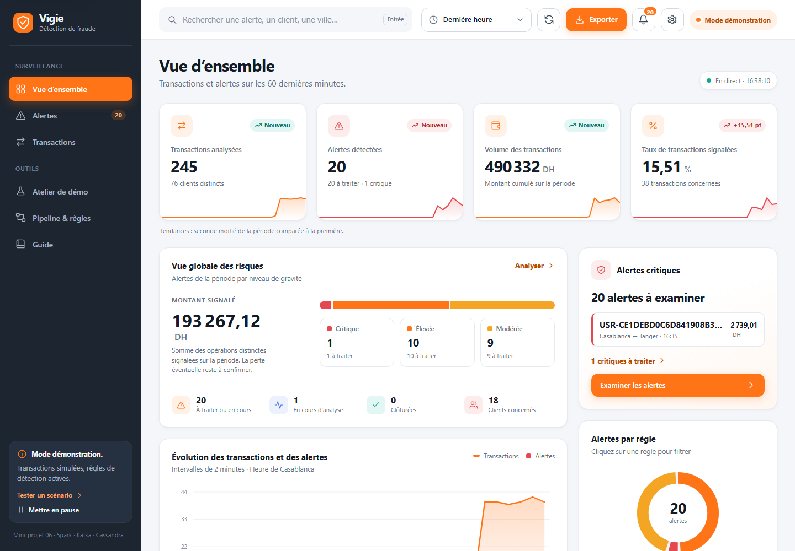

# Vigie

Console de surveillance des transactions financières et pipeline de détection de fraude.

Mini-projet 06 · **Spark Structured Streaming · Kafka · Cassandra**

Le pipeline Kafka → Spark → Cassandra a fait l’objet d’une recette le 18 novembre 2026. Voir le [relevé de validation](docs/validation.md) pour connaître les vérifications disponibles après la correction de l’ingestion.

L’interface, les messages et la documentation sont en français. Les montants sont exprimés en dirhams. La console affiche les heures du Maroc ; les échanges et le stockage utilisent UTC.



[Aperçu mobile](docs/apercu-mobile.png) · [Atelier de démo](docs/apercu-atelier.png) · [Vérifications effectuées](docs/validation.md)

## Démarrage immédiat

Python **3.10 ou supérieur** suffit pour utiliser la démonstration. Aucun paquet à installer.

```bash
python3 app.py
```

Ouvrir **http://127.0.0.1:8000**. Arrêter avec `Ctrl+C`.

Sous Windows, utiliser `python app.py` ou `py app.py` si la commande `python3` n’est pas disponible. Remplacer de même `python3` par `python` dans les commandes suivantes.

La première ouverture crée un historique de démonstration et un fichier `.runtime/vigie.sqlite3`. Le flux ajoute par défaut une transaction toutes les trois secondes ; sa cadence est réglable dans l’atelier. Les données, les alertes et les statuts sont conservés après fermeture. Si le dernier événement date de plus de quinze minutes au redémarrage, un historique récent est ajouté. Le bandeau « Démonstration » identifie l’origine des données.

Pour choisir un autre port ou un fichier de données distinct :

```bash
python3 app.py --port 8001 --database .runtime/presentation.sqlite3
```

## Utiliser la console

| Page | Usage |
| --- | --- |
| Vue d’ensemble | Volume financier, transactions, alertes, activité temporelle et répartition par ville |
| Alertes | Recherche sans distinction d’accents, filtres, tri par priorité ou montant, détail et suivi |
| Transactions | Journal filtrable et identification des opérations associées à une alerte |
| Atelier de démo | Scénarios paramétrables, résultats détaillés, accès direct aux transactions et alertes produites |
| Pipeline & règles | Architecture, seuils, état des services et injection de scénarios locaux |
| Guide du projet | Repères d’utilisation et liste des livrables |

La vue d’ensemble propose une file d’investigation : accès aux dossiers ouverts par priorité et raccourci vers les alertes critiques non clôturées. Le montant signalé additionne les opérations distinctes, sans représenter une perte confirmée.

Les nouvelles alertes conservent toutes leurs transactions associées : les deux paiements d’un déplacement et les membres d’une fenêtre de fréquence. La fiche affiche ces éléments. Les anciens enregistrements restent lisibles ; un avertissement signale les preuves historiques incomplètes.

La période sélectionnée s’applique à tous les indicateurs. L’export CSV reprend les filtres actifs et toutes les pages de résultats. Une alerte peut être marquée **nouvelle**, **en cours**, **confirmée** ou **écartée** ; ce suivi est un journal local, indépendant des données brutes de Cassandra.

Dans l’atelier, comparez **10 000 DH** et **10 000,01 DH**, choisissez les villes et le temps de déplacement, ou faites varier la fréquence de **2 à 8 paiements**. Le résultat affiche chaque transaction, le client distinct utilisé pour l’essai et les alertes produites. Une fréquence de huit paiements actualise une seule alerte. Le flux automatique peut être mis en pause et sa cadence réglée à 1, 3 ou 5 secondes.

La fiche d’alerte permet de parcourir la sélection avec « Précédente / Suivante » et d’ouvrir les transactions du client. L’onglet « À traiter » réunit les alertes nouvelles et celles en cours d’analyse.

## Règles

| Règle | Condition | Niveau |
| --- | --- | --- |
| Montant élevé | Montant **strictement supérieur à 10 000 DH** | Élevé |
| Déplacement impossible | Même client, intervalle **≤ 120 s**, distance **≥ 50 km**, vitesse **> 900 km/h** | Critique |
| Fréquence inhabituelle | **Au moins 3 transactions distinctes** par client dans une fenêtre fixe de **2 minutes** | Modéré |

Le seuil de trois transactions, la vitesse et la distance minimale précisent les règles laissées ouvertes dans le sujet. Les fenêtres sont fixes, alignées sur les minutes UTC paires. Elles ne constituent pas une fenêtre glissante. Les deux côtés d’un déplacement peuvent arriver dans le désordre.

Le référentiel couvre Casablanca, Rabat, Marrakech, Tanger, Fès, Agadir, Oujda et Meknès. Les distances sont des distances à vol d’oiseau entre centres de villes ; l’alerte signale une incohérence à examiner.

## Pipeline complet — déploiement Docker

Le mode cluster nécessite Docker Engine et Compose v2 sur la machine qui lance la console. Prévoir environ **6 à 8 Go de mémoire** disponibles pour Docker et l’accès aux registres d’images et à Maven lors du premier démarrage.

Versions testées : Kafka **3.9.0**, Spark **3.5.3** / Scala **2.12**, Spark Cassandra Connector **3.5.1**, Cassandra **4.1.7**. Le code Python n’utilise ni `kafka-python` ni `cassandra-driver` : le producteur passe par le CLI Kafka du conteneur, et la console lit Cassandra avec son `cqlsh`.

Les commandes suivantes sont à lancer lorsque l’environnement Docker et les téléchargements sont autorisés.

**1. Démarrer les services et initialiser les tables et les topics :**

```bash
docker compose up -d
docker compose ps -a
```

Les services `volume-init`, `kafka-init` et `cassandra-init` doivent se terminer avec le code 0. Le master Spark et le worker démarrent après l’initialisation. Cassandra peut prendre une à trois minutes pour être prêt.

Pour reprendre le projet après avoir exécuté l’ancienne version du job, suivre la [procédure de démarrage avec des volumes distincts](docs/recette.md#premier-démarrage-après-la-correction-de-lingestion).

**2. Soumettre le job dans un terminal dédié :**

```bash
bash submit.sh
```

Le script lance `spark-submit` sur le master et résout les deux connecteurs Maven. Les fichiers JAR sont mis en cache dans un volume. Laisser ce terminal ouvert ; `Ctrl+C` arrête le job. Si le terminal a été fermé, arrêter le job avec `bash submit.sh --stop`. Un seul job peut tourner à la fois : une seconde soumission est refusée.

Depuis PowerShell, appeler Git Bash explicitement : `& "C:\Program Files\Git\bin\bash.exe" submit.sh`. La commande `bash` de PowerShell désigne souvent WSL. Si `docker` est introuvable, ajouter le dossier `resources\bin` de Docker Desktop au `PATH`, par exemple `$env:PATH += ";$env:LOCALAPPDATA\Programs\DockerDesktop\resources\bin"` selon l’installation.

**Indisponibilité de Cassandra.** Une écriture en échec est retentée pendant environ 90 secondes. Au-delà, seule la requête concernée est relancée depuis son checkpoint. Si le job s’arrête, `submit.sh` attend 20 secondes entre les nouvelles soumissions et autorise cinq relances consécutives. Les reprises utilisent les checkpoints et les données conservées dans les volumes. Une alerte peut être republiée dans `fraud-alerts` (livraison au moins une fois).

**3. Alimenter Kafka dans un deuxième terminal :**

```bash
python3 producer.py --kafka --count 300 --interval 0.5
```

Pour vérifier une règle isolée :

```bash
python3 producer.py --kafka --scenario montant --count 1
python3 producer.py --kafka --scenario voyage --count 1
python3 producer.py --kafka --scenario frequence --count 1
```

**4. Ouvrir la console sur les données de Cassandra :**

```bash
python3 app.py --mode cluster --database .runtime/cluster.sqlite3
```

Ne pas laisser la console de démonstration utiliser le même port : sous Windows, deux serveurs peuvent écouter le même port sans erreur et se partager les requêtes. Une erreur de lecture Cassandra est affichée comme telle, sans données de substitution. La console répond aux adresses `localhost`, `127.0.0.1` ou à une adresse IP, et refuse les autres noms d’hôte (protection contre le DNS rebinding).

**5. Lire directement le topic d’alertes :**

```bash
docker compose exec kafka /opt/kafka/bin/kafka-console-consumer.sh --bootstrap-server kafka:19092 --topic fraud-alerts --from-beginning
```

Vérifier les rejets de contrat avec la même commande en remplaçant le topic par `invalid-transactions`.

**6. Arrêter les services en conservant les volumes :**

```bash
docker compose stop
```

Arrêter d’abord le job avec `Ctrl+C` ou `bash submit.sh --stop`. Les données Kafka, Cassandra, les checkpoints et le cache Maven sont conservés. `docker compose start` redémarre les services existants ; relancer ensuite `bash submit.sh`.

## Contrat JSON

```json
{
  "transaction_id": "TXN-99823",
  "card_holder_id": "USR-401",
  "amount": 14500.00,
  "location": "Casablanca",
  "merchant_type": "Jewelry",
  "timestamp": "2026-10-06T08:55:00Z"
}
```

Les six champs sont obligatoires. Les identifiants contiennent de 1 à 64 lettres ASCII, chiffres, tirets ou underscores. Le montant est positif et limité à deux décimales. L’horodatage suit le format `AAAA-MM-JJTHH:MM:SS`, avec une fraction facultative de un à six chiffres et un fuseau `Z` ou `±HH:MM`. Le flux conserve la précision à la microseconde.

Spark compare le temps événement à l’heure d’arrivée enregistrée par Kafka et rejette tout écart futur de plus de cinq minutes. La démonstration applique la même tolérance au moment de l’ingestion locale. Spark conserve le premier enregistrement valide de chaque identifiant avant de l’envoyer aux règles et à Cassandra. Dans un même micro-lot, l’heure d’arrivée, la partition et l’offset départagent les doublons.

Produire du NDJSON sans Kafka :

```bash
python3 producer.py --scenario mix --count 20 --interval 0 > transactions.ndjson
```

## Validation

```bash
python3 -m unittest discover -v
python3 -m compileall -q app.py fraud_core.py storage.py producer.py streaming_cassandra.py
bash -n submit.sh && bash -n scripts/init-topics.sh
```

Les tests couvrent les bornes des seuils, les événements désordonnés, les fenêtres fixes, les doublons, les upserts, la persistance du suivi, la cohérence des indicateurs, les routes HTTP, les seuils partagés entre Python et Spark, le contrat d’horodatage commun et la politique de relance face à Cassandra. Ils n’exécutent pas le moteur Spark.

La recette du 18 novembre 2026 a vérifié les cinq requêtes Spark, les deux sorties d’alertes, le rejeu et la reprise sur checkpoints. Voir le [relevé des essais](docs/validation.md) et le [protocole reproductible](docs/recette.md).

## Organisation

```text
app.py                    Serveur HTTP et indicateurs de supervision
fraud_core.py             Règles métier et génération de transactions
storage.py                SQLite local et lecture Cassandra via cqlsh
producer.py               Générateur NDJSON et publication Kafka
streaming_cassandra.py    Requêtes Spark, règles, sinks Kafka et Cassandra
submit.sh                 Soumission Spark et dépendances Maven
schema.cql                Keyspace et tables orientées requêtes
compose.yaml              Cluster Docker, réseau, volumes et initialisation
scripts/init-topics.sh    Création idempotente des topics
web/                      Interface HTML, CSS et JavaScript sans framework
tests/                    Tests standard-library unittest
docs/rapport.md           Rapport technique en français
docs/recette.md           Démonstration et validation du cluster
```

Le rapport décrit le [modèle de données, les garanties de livraison et les limites](docs/rapport.md). Les contrôles de disponibilité sont volontairement distincts de la bonne exécution du pipeline. Les ports publiés sont limités à l’interface locale.
