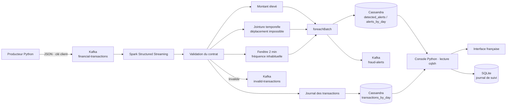

# Vigie — Détection de fraude financière en streaming

**Mini-projet 06 · Spark Structured Streaming, Kafka et Apache Cassandra**

## 1. Objectif et périmètre

Le projet traite un flux de transactions financières pour repérer des montants inhabituels et des déplacements géographiquement incohérents, puis conserve les alertes pour consultation. Il associe un pipeline distribué et une console de supervision en français.

Le sujet impose deux topics, `financial-transactions` et `fraud-alerts`, des fenêtres de deux minutes, le keyspace `fraud_monitoring`, la table `detected_alerts` et une soumission Spark avec les connecteurs Kafka et Cassandra. La solution ajoute un journal des transactions, un topic de rejet et un suivi d’investigation local.

La console peut être utilisée de deux façons :

- **Démonstration** : génération et détection en Python, persistance SQLite. Ce mode permet d’examiner l’interface sans installer de composant externe.
- **Cluster** : production Kafka, traitement Spark et persistance Cassandra. La console interroge Cassandra depuis le poste Docker avec `cqlsh`.

Le choix du mode est explicite au lancement. Le mode de démonstration ne mesure ni les performances ni la disponibilité de Kafka, Spark ou Cassandra.

## 2. Correspondance avec le sujet

| Exigence du PDF | Réalisation | Vérification prévue |
| --- | --- | --- |
| Topic d’entrée `financial-transactions` | Création à trois partitions, clé de production par client | Lecture CLI du topic |
| Topic de sortie `fraud-alerts` | Publication JSON par micro-lot, clé `alert_id` | Observation d’un scénario isolé |
| Montant > 10 000 DH | Filtre strict sur un montant décimal | Cas à 10 000 puis 10 000,01 DH |
| Fenêtres de 2 minutes | Agrégation fixe par client et détection de fréquence | Trois transactions dans une même fenêtre |
| Impossible travel | Jointure temporelle bornée et distance de Haversine | Casablanca puis Tanger en 40 secondes |
| Persistance Cassandra | Connecteur DataFrame, upserts déterministes | Lecture CQL ciblée |
| Partitionnement par date et client | Clé `((alert_date, card_holder_id), timestamp, alert_id)` | Vérification du DDL et requête par partition |
| Cluster conteneurisé | Compose, KRaft, master et worker Spark, Cassandra | Santé, initialisation et enregistrement du worker |
| `submit.sh` | Soumission en mode client, deux packages Maven | Lancement et observation de cinq requêtes |
| `streaming_cassandra.py` | Pipeline et sinks | Recette de bout en bout |
| `schema.cql` | DDL idempotent du keyspace et des tables | Réexécution sans erreur |

## 3. Architecture



Spark héberge cinq requêtes indépendantes : rejets, transactions, montants, déplacements et fréquences. Chaque requête possède son propre checkpoint. La jointure avec état et l’agrégation avec état sont dans des requêtes distinctes pour éviter leur chaînage.

Le flux brut est lu séparément par les requêtes. Cela coûte davantage de lectures qu’un système de production avec une couche de normalisation intermédiaire, mais garde le projet lisible et les garanties de reprise explicites.

### Réseau et ressources

Kafka utilise un listener interne `kafka:19092`, un listener hôte `localhost:9092` et un listener de contrôleur KRaft. Un client conteneurisé reçoit ainsi une adresse qu’il peut résoudre ; `localhost` ne lui est pas annoncé comme adresse du broker interne.

Le driver Spark est lancé dans le conteneur master et annonce `spark-master`. Le worker dispose de deux cœurs et de 2 Go ; l’exécuteur utilise 1 Go. Le master et le worker montent les checkpoints **au même chemin dans le même volume**. Cette configuration vise un hôte Docker unique. Un cluster multi-hôtes exige un système de fichiers partagé adapté aux checkpoints.

Les volumes Kafka et Cassandra conservent les données. Un volume distinct conserve les JAR Maven. Les ports de consultation sont publiés sur `127.0.0.1` : console 8000, Kafka 9092, Cassandra 9042, master Spark 8080, worker 8081 et interface du driver 4040.

## 4. Données et validation

Une transaction comporte les six champs indiqués dans le sujet. Le montant Spark est un `DecimalType(12, 2)`. Les catégories commerciales sont conservées telles que reçues ; la catégorie `Jewelry` de l’exemple reste donc acceptée.

Les contrôles portent sur la présence des champs, les identifiants, le montant positif, la catégorie non vide, le référentiel géographique et un horodatage avec fuseau. Un horodatage futur de plus de cinq minutes est rejeté pour éviter de faire avancer artificiellement le watermark. Les rejets conservent le message brut et un motif dans `invalid-transactions`.

Les données sont normalisées en UTC. La console convertit l’affichage avec le fuseau `Africa/Casablanca`, qui prend en compte les changements de décalage propres au Maroc. L’export conserve UTC pour faciliter les rapprochements.

Le contrat de production impose un identifiant unique par transaction. Le producteur génère ces identifiants, utilise le client CLI Kafka avec `acks=all` et active son idempotence. La démonstration ignore les transactions dont l’identifiant existe déjà. La fréquence Spark compte un ensemble d’identifiants distincts ; les alertes de montant et de déplacement utilisent des identifiants déterministes.

## 5. Détection

### 5.1 Montant élevé

La condition est `amount > 10000`. Une transaction égale à 10 000 DH est acceptée sans alerte de montant. Une transaction à 10 000,01 DH déclenche la règle. Cette règle ne nécessite pas d’état.

### 5.2 Déplacement impossible

Deux transactions du même client sont rapprochées lorsque leur intervalle est compris entre zéro et 120 secondes. Le départ et l’arrivée sont déterminés par le temps événement ; l’identifiant départage les horodatages égaux. L’ordre d’arrivée dans Kafka n’impose donc pas l’ordre du déplacement.

La distance entre les villes est calculée avec la formule de Haversine :

\[
d = 2R\arcsin\sqrt{\sin^2\left(\frac{\Delta\varphi}{2}\right)
 + \cos\varphi_1\cos\varphi_2\sin^2\left(\frac{\Delta\lambda}{2}\right)}
\]

avec \(R = 6371{,}0088\) km. La vitesse estimée est \(v = 3600d/\max(\Delta t,1)\), avec \(\Delta t\) en secondes. Le plancher d’une seconde traite les transactions simultanées sans division par zéro.

L’alerte nécessite une distance d’au moins 50 km et une vitesse supérieure à 900 km/h. Le plancher de distance évite d’interpréter une faible différence de géolocalisation comme un déplacement impossible. Les centres de villes remplacent ici une géolocalisation précise : ce choix est adapté à la démonstration et constitue une limite du modèle.

Les deux côtés de la jointure portent un watermark de dix minutes et une contrainte temporelle explicite. L’état peut ainsi être purgé. Les événements trop tardifs peuvent ne plus participer à la détection avec état ; ils restent éligibles à la règle de montant et au journal des transactions.

### 5.3 Fréquence inhabituelle

Le sujet demande des fenêtres de deux minutes sans fixer de seuil de fréquence. La solution retient au moins trois transactions distinctes par client dans une fenêtre fixe. Chaque transaction appartient à une seule fenêtre, déterminée par son horodatage UTC.

L’agrégation utilise le mode `update` : dès que le seuil est atteint, l’alerte est publiée au micro-lot suivant. Les événements supplémentaires actualisent son compteur. Il n’est pas nécessaire qu’un nouveau flux fasse dépasser au watermark la fin de la fenêtre pour voir la première alerte.

L’identifiant de l’alerte et son horodatage de clé Cassandra sont calculés à partir du client et du début de fenêtre. La clé de stockage reste donc stable quand la dernière transaction change. Le JSON conserve l’horodatage de cette dernière transaction pour la consultation.

## 6. Modèle Cassandra

### Table principale

```cql
PRIMARY KEY ((alert_date, card_holder_id), timestamp, alert_id)
```

Le partitionnement regroupe les alertes d’un client sur un jour UTC. La date borne la taille de partition. L’ordre décroissant sur `timestamp` permet de consulter les événements récents en premier. `alert_id` distingue les règles et les paires de transactions.

Une consultation ciblée fournit la date et le client :

```cql
SELECT * FROM fraud_monitoring.detected_alerts
WHERE alert_date = '2026-10-06' AND card_holder_id = 'USR-401';
```

### Tables de consultation

La console doit consulter plusieurs clients sur une période. Scanner la table principale ou utiliser `ALLOW FILTERING` contredirait le modèle de requêtes Cassandra. Deux tables supplémentaires sont donc maintenues :

| Table | Partition | Clustering | Usage |
| --- | --- | --- | --- |
| `detected_alerts` | Jour + client | Horodatage, alerte | Investigation d’un client |
| `alerts_by_day` | Jour | Horodatage, alerte | Liste des alertes et indicateurs |
| `transactions_by_day` | Jour | Horodatage, transaction | Journal et volume financier |

Le payload JSON conserve le contrat de consultation sans imposer de pilote Python à la console. Il contient aussi la liste triée `related_transaction_ids` : une identité pour un montant, les deux identités d’un déplacement et les identités distinctes de la fenêtre de fréquence. Ce champ ne change ni les clés Cassandra ni le schéma CQL. Cette dénormalisation entraîne plusieurs écritures par événement, en contrepartie de lectures prévisibles.

La partition quotidienne des tables de consultation convient au volume de ce projet. À grande échelle, il faudrait la subdiviser en tranches horaires et en buckets, puis agréger les indicateurs séparément. La console limite la période à 24 heures et le chargement aux 10 000 événements les plus récents par type ; cette limite est signalée quand elle est atteinte.

## 7. Livraison, idempotence et reprise

`foreachBatch` fournit une exécution **au moins une fois**. Les écritures Cassandra, la table de consultation et Kafka ne forment pas une transaction distribuée.

Chaque identifiant d’alerte est un SHA-256 déterministe :

- montant : règle + identifiant de transaction ;
- déplacement : règle + identifiants des deux transactions triés ;
- fréquence : règle + client + numéro de fenêtre.

Une reprise rejoue les écritures Cassandra avec la même clé. Elles deviennent des upserts et ne créent pas d’alerte supplémentaire. La clé temporelle de fréquence reste fixe pendant les mises à jour de la fenêtre.

Un arrêt après une écriture Kafka mais avant la validation du micro-lot peut republier le même message. Un consommateur doit stocker les alertes par `alert_id` et appliquer les valeurs les plus récentes dans l’ordre Kafka. Il ne doit pas éliminer indistinctement toutes les occurrences d’un identifiant : une alerte de fréquence peut porter un compteur actualisé. La console lit Cassandra et déduplique les identifiants au chargement.

Les indicateurs de signalement utilisent l’union des identités associées aux alertes, puis son intersection avec le journal de la période. Chaque transaction contribue une seule fois au montant et au taux, même si plusieurs règles la concernent. Les alertes historiques sans liste complète déclenchent un avertissement ; aucun historique n’est effacé ou réécrit.

Les requêtes de journal et de détection progressent indépendamment. Une alerte peut être visible avant sa transaction dans la table de consultation. La console indique alors que les indicateurs financiers sont provisoires ; elle ne prétend pas disposer d’une vue atomique du flux.

Les checkpoints sont conservés entre les soumissions. Une évolution incompatible du schéma d’état nécessite une stratégie de migration et un nouveau chemin de checkpoint ; le projet n’efface jamais les anciens checkpoints automatiquement.

## 8. Interface et investigation

La navigation distingue la surveillance des données et l’exploitation du pipeline. Les filtres restent visibles, les montants sont alignés à droite et les niveaux ne reposent pas uniquement sur une couleur. Le détail d’une alerte s’ouvre dans un panneau et expose son motif, le client, la transaction et les éléments géographiques disponibles.

Le suivi d’investigation est enregistré dans SQLite : il persiste sans modifier le résultat de détection. Confirmer une alerte ne revient donc pas à effacer les faits d’origine. Les exports portent l’environnement et les filtres actifs. Les valeurs CSV susceptibles d’être interprétées comme des formules sont neutralisées.

L’atelier de démonstration permet de modifier le montant, les villes, l’intervalle de déplacement et le nombre de paiements. Chaque essai utilise un client identifié par un UUID complet, puis expose les transactions produites et les alertes distinctes. Les résultats sont accessibles directement, sans recherche manuelle d’un identifiant. Les paiements de fréquence ne sont jamais datés dans le futur, y compris à une frontière de fenêtre. Un redémarrage après une période d’inactivité ajoute un historique récent en conservant les données et le suivi déjà enregistrés.

La recherche ignore les accents. Les alertes peuvent être triées par priorité ou montant et leurs filtres effacés en une action. L’onglet « À traiter » inclut les statuts nouvelle et en cours. La navigation entre fiches conserve l’ordre de la sélection ; une sauvegarde retardée ne ferme pas une autre fiche ouverte entre-temps.

L’interface utilise HTML, CSS et JavaScript natifs, sans CDN, police distante ou bibliothèque graphique. Les graphiques SVG s’appuient sur les données effectivement reçues. Un état vide, une connexion indisponible et une limitation de chargement disposent d’un message propre.

## 9. Validation et limites

Les tests locaux vérifient les règles métier, les seuils, les événements désordonnés, les doublons, le stockage, les statuts, le contrat du producteur et le serveur HTTP. Les scripts Bash et la syntaxe Python et JavaScript sont vérifiables séparément. Le protocole [recette.md](recette.md) décrit la démonstration et la validation du cluster.

Le déploiement sur Docker Desktop a validé les trois règles, les rejets, la mise à jour des fenêtres, le rejeu et la reprise avec les volumes existants. La console a lu les résultats de Cassandra. Le [relevé de validation](validation.md) donne les effectifs et les mesures.

Le déploiement Compose comporte un broker et un nœud Cassandra, avec réplication à 1. Il sert au développement et à la soutenance. Il ne fournit ni haute disponibilité, ni authentification multi-utilisateur, ni configuration de production. Les règles sont explicables, mais ne constituent pas une classification certaine de la fraude.

## Références techniques

- Sujet fourni : « Mini-Projet 6 - Pipeline Streaming Spark Kafka Cassandra », une page (document de l’enseignant, non inclus dans le dépôt).
- [Spark — Structured Streaming](https://spark.apache.org/docs/3.5.6/structured-streaming-programming-guide.html) : watermarks, jointures, modes de sortie et `foreachBatch`. La documentation consultée est celle de la branche 3.5, patch 3.5.6 ; le runtime préparé est 3.5.3.
- [Spark — Intégration Kafka](https://spark.apache.org/docs/3.5.6/structured-streaming-kafka-integration.html) : source et sink Kafka, dépendances JVM.
- [Spark Cassandra Connector](https://github.com/apache/cassandra-spark-connector) : matrice Spark 3.5 / Scala 2.12 / Cassandra 4.x et coordonnées de version 3.5.1.
- [Kafka 3.9 — Configuration Docker KRaft](https://github.com/apache/kafka/blob/3.9.0/docker/examples/docker-compose-files/single-node/plaintext/docker-compose.yml) : listeners internes et externes.
- [Image officielle Cassandra](https://hub.docker.com/_/cassandra) : configuration et persistance du conteneur. Le tag exact préparé doit être confirmé au téléchargement.

## Revue de conformité et améliorations

Voir [audit.md](audit.md) pour la correspondance avec chaque exigence du sujet, les corrections apportées et les validations restant à mener. Les contrôles exécutés sont consignés dans [validation.md](validation.md).
